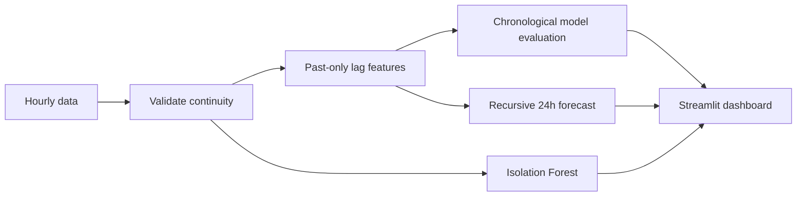

<p align="center"></p>

<h1 align="center">⚡ GridPulse AI</h1>
<p align="center"><strong>Energy Demand Forecasting & Consumption Intelligence</strong></p>
<p align="center">   </p>

> **Educational prototype:** Uses synthetic hourly electricity consumption by default. Do not use its forecasts for grid operations, actual billing, or commercial decisions without real-world validation.

## The problem

Energy consumption fluctuates throughout the day. Analysts need accessible tools to understand demand patterns, investigate unusual readings, and explore short-term forecasts. GridPulse AI turns hourly observations into an interactive, reproducible analytics workflow.

## Features

| Dashboard | Capabilities |
|---|---|
| 📊 Overview | Consumption totals, peak and average hourly usage, illustrative cost, hourly patterns |
| 🔮 Forecast | Next 24 hours of recursive model estimates and CSV export |
| 🚨 Anomalies | Isolation Forest statistical outlier screening and export |
| 🧪 Evaluation | Chronological 80/20 holdout, MAE, RMSE, actual vs predicted |
| 📂 Data | Validated hourly CSV upload, inspection and download |

## Architecture

<p align="center"></p>



## Modeling methodology

- **Forecast model:** scikit-learn `RandomForestRegressor`, with hour, weekday, observed temperature, 24-hour and 168-hour lag, and previous 24-hour average. Lags use earlier observations only.
- **Holdout:** First 80% of feature-ready records train the model, final 20% evaluate one-step predictions. MAE and RMSE are computed on that holdout, **not** on recursive 24-hour forecasts.
- **Forecast:** A model is refitted on all historical records, then predicts each of the next 24 hours recursively. Last-observed temperature is assumed constant. This simplification and recursive error accumulation limit accuracy.
- **Anomaly detection:** Isolation Forest flags unusual combinations of demand and temperature. Flags are not confirmed faults or fraud.

## Quick start

Requires Python 3.11+.

```bash
git clone https://github.com/muhammadzubair-data/gridpulse-ai-energy-demand-intelligence.git
cd gridpulse-ai-energy-demand-intelligence
python -m venv .venv
# Windows: .venv\Scripts\activate
# Linux/macOS: source .venv/bin/activate
pip install -r requirements.txt
streamlit run app.py
```

## CSV input

Upload at least 15 days of continuous, unique hourly timestamps with these columns:

```csv
timestamp,demand_kwh,temperature_c
2025-01-01 00:00:00,145.1,19.2
2025-01-01 01:00:00,142.7,19.0
```

These are **illustrative rows**, not a sufficient dataset. Demand is hourly energy in kWh, not instantaneous power in kW. Uploaded readings are validated for gaps, missing values, and negative consumption.

## Testing

```bash
python -m pytest -q
python -m compileall -q app.py gridpulse
```

CI runs on GitHub Actions with Python 3.11.

## Deployment

Publish the repository on GitHub, then create a Streamlit Community Cloud app using branch `main` and entry point `app.py`. Verify the public deployment before adding its URL here.

## Project structure

```text
gridpulse-ai/
├── app.py
├── gridpulse/core.py
├── tests/test_core.py
├── assets/hero.svg
├── assets/architecture.svg
├── .github/workflows/ci.yml
├── requirements.txt
├── GITHUB_UPLOAD_PROMPT.md
├── LICENSE
└── README.md
```

## Limitations

Synthetic data does not validate real-world forecasting performance. There is no weather forecast integration, real-time metering, tariff engine, calibrated uncertainty interval, or separately measured multi-step backtest. The flat-rate cost calculator is illustrative and excludes taxes, time-of-use charges, and demand charges. Avoid uploading sensitive data to an unreviewed public deployment.

## Roadmap

Rolling-origin backtesting; horizon-specific metrics; external datasets; weather forecasting; calibrated uncertainty intervals; time-of-use tariffs; secure production data connectors.

## Author

**ZubairLabs** · [Portfolio](https://zubairlabs.com) · [GitHub](https://github.com/muhammadzubair-data)

MIT licensed. Built for reproducible learning and portfolio demonstration.
