<p align="center">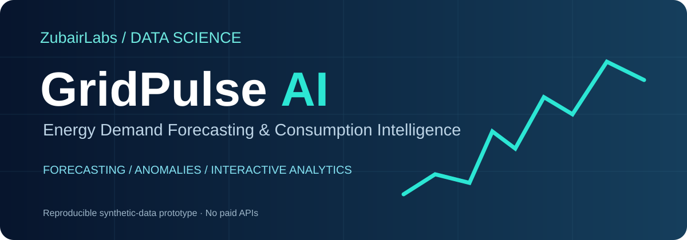</p>

<h1 align="center">GridPulse AI</h1>

<p align="center"><strong>Energy demand forecasting, anomaly screening and tariff cost insight in one Streamlit dashboard</strong><br/>
A reproducible machine-learning portfolio project by <a href="https://zubairlabs.com">ZubairLabs</a>, built on clearly labelled synthetic data.</p>

<p align="center">
  <a href="https://gridpulse-ai-zubairlabs.streamlit.app"></a>
  <a href="https://github.com/muhammadzubair-data/gridpulse-ai-energy-demand-intelligence/actions/workflows/ci.yml"></a>
  
  
  
  
  
  
</p>

<p align="center">
  <a href="#live-demo">Live demo</a> ·
  <a href="#key-capabilities">Capabilities</a> ·
  <a href="#dashboard-screenshots">Screenshots</a> ·
  <a href="#model-evaluation-methodology-and-results">Results</a> ·
  <a href="#installation-and-quick-start">Quick start</a> ·
  <a href="#limitations">Limitations</a>
</p>

> [!IMPORTANT]
> **Educational prototype, not a production forecasting system.** By default every reading comes from a documented simulation in [`gridpulse/core.py`](gridpulse/core.py). The metrics below show how well the model recovers that simulated pattern. They are not evidence of real-world accuracy, and no energy or cost savings are claimed. There is no live meter, weather service or utility connection.

## Live demo

**https://gridpulse-ai-zubairlabs.streamlit.app**

Deployed on Streamlit Community Cloud (Python 3.12, entry point `app.py`, branch `main`) and checked in a browser on 21 November 2026:

- all six pages load, and the day-ahead MAE (6.55 kWh), baselines and forecast (3.11 MWh for the next 24 h) match the numbers below;
- changing the horizon to 48 h and the temperature by +4 °C updates the forecast and shows the beyond-24-hour warning;
- the anomaly screen and the flat / time-of-use tariff switch respond as expected;
- a deliberately messy CSV (a duplicate timestamp and a 2-hour gap) was repaired, analysed, and stayed the active data source while moving between pages.

The first visit after a quiet period may show Streamlit's "waking up" screen; training and the backtest then take a few seconds and are cached.

<p align="center">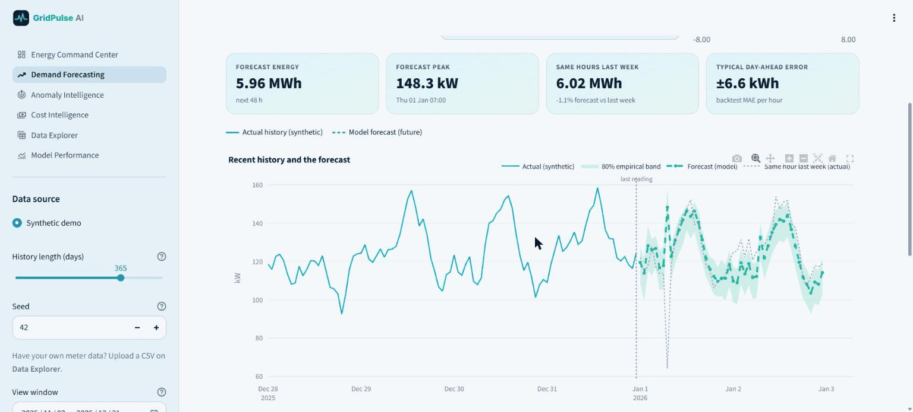</p>

## Contents

1. [Executive overview](#executive-overview)
2. [Business problem and solution](#business-problem-and-solution)
3. [Key capabilities](#key-capabilities)
4. [System architecture](#system-architecture)
5. [Forecasting pipeline](#forecasting-pipeline)
6. [Dataset](#dataset)
7. [Technology stack](#technology-stack)
8. [Dashboard screenshots](#dashboard-screenshots)
9. [Model evaluation methodology and results](#model-evaluation-methodology-and-results)
10. [Installation and quick start](#installation-and-quick-start)
11. [Example usage](#example-usage)
12. [Testing and GitHub Actions](#testing-and-github-actions)
13. [Deploying to Streamlit Community Cloud](#deploying-to-streamlit-community-cloud)
14. [Project structure](#project-structure)
15. [Limitations](#limitations)
16. [Roadmap](#roadmap)
17. [Author](#author)

## Executive overview

GridPulse AI turns a year of hourly electricity readings into four practical answers:

- **How much will we use tomorrow?** A Random Forest forecasts the next 24 hours recursively, with an error band taken from past forecast errors.
- **Which hours look wrong?** An Isolation Forest flags spikes, dips and stuck readings against what is typical for that hour, day type and temperature.
- **What does it cost?** A configurable flat or time-of-use tariff, with demand and fixed charges, prices both history and forecast.
- **Can we trust the model?** A day-ahead backtest compares it with two simple baselines on months it never saw.

It runs on synthetic data out of the box and accepts your own hourly CSV, which it validates and can repair.

## Business problem and solution

Facilities and energy teams usually see consumption after the fact, on a monthly bill. By then a forgotten chiller, a stuck meter or a costly peak-hour pattern has already been paid for. What helps is an hourly view: what is normal, what is coming, and what is unusual.

| Need | How GridPulse addresses it |
|:--|:--|
| Plan the next day | Recursive 24-hour forecast that uses only information available at forecast time |
| Know how far to trust a forecast | Day-ahead backtest, horizon-by-horizon error, empirical 80% band |
| Spot problems early | Residual-based anomaly screen with "higher", "lower" and "flat / stuck" labels |
| Understand cost drivers | Flat or time-of-use tariff, demand charge on monthly peak, load-shift what-if |
| Use your own data | CSV upload with validation, optional repair of duplicates and short gaps, exports |

## Key capabilities

| Page | What you can do |
|:--|:--|
| **Energy Command Center** | Energy, average and peak demand, load factor; daily energy with temperature; weekday and weekend profiles; weekday × hour heatmap; temperature sensitivity; load duration curve |
| **Demand Forecasting** | 6 to 72 hour recursive forecast; choose the temperature assumption and shift it ±8 °C; compare with the same hours last week; empirical error band; CSV export |
| **Anomaly Intelligence** | Choose the share of hours to flag; actual vs expected demand with flagged hours; residual distribution; flags by hour; ranked table with scores; precision and recall against the synthetic answer key; CSV export |
| **Cost Intelligence** | Flat or time-of-use rates, peak window, weekend handling, demand and fixed charges; monthly cost by component; cost by hour; next-24-hour cost from the forecast; load-shift what-if |
| **Data Explorer** | CSV upload with validation and repair, template download, data-quality summary, feature-availability table, distributions, three exports (view, full dataset, evaluation JSON) |
| **Model Performance** | Day-ahead backtest and one-step tables against baselines, error by horizon, permutation importance, holdout and backtest charts, error by hour, methodology |

**Design.** Deep navy, electric cyan and emerald, in light and dark themes. Every chart labels its lines as *actual*, *model estimate* or *forecast*, and a banner states whether the data is synthetic or uploaded.

## System architecture

<p align="center">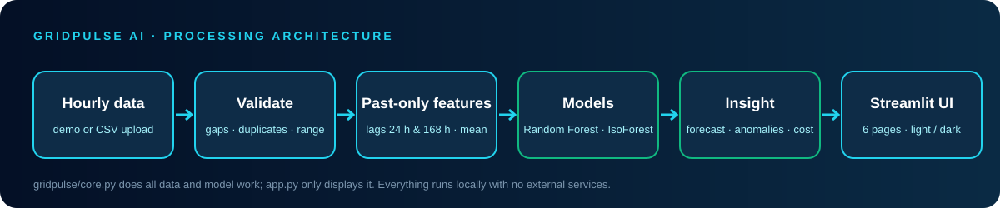</p>

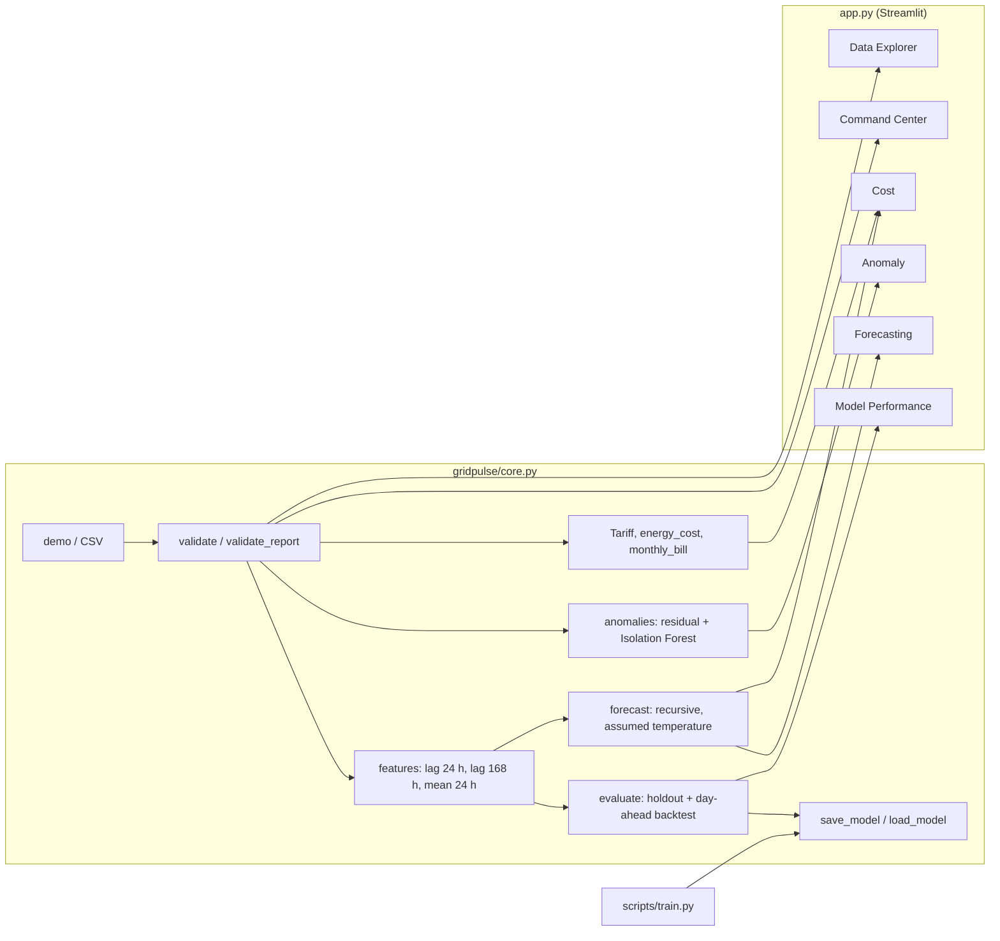

All data and model logic lives in `gridpulse/core.py`; `app.py` only presents it. Nothing calls an external service.

## Forecasting pipeline

<p align="center">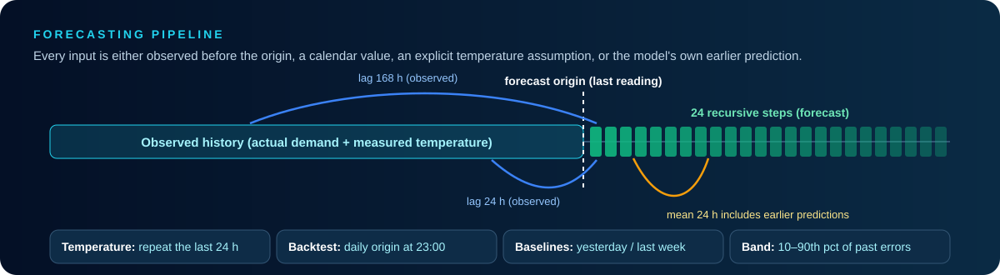</p>

**What the model sees for hour *t***

| Feature | Source | Known at forecast time? |
|:--|:--|:--|
| `hour`, `weekday` | Calendar | Yes |
| `lag24`, `lag168` | Demand 24 h and 168 h before *t* | Yes, for every hour up to 24 h ahead |
| `mean24` | Mean demand of the 24 hours before *t* | Observed for the first step; afterwards it includes the model's own predictions |
| `temperature_c` | Measured in history | **No.** The forecast uses an explicit assumption: by default, repeat the last 24 observed hourly temperatures |

**How leakage is prevented, and tested**

- Features are built with `shift`, so changing a reading can only change features *after* it (`test_features_use_only_past_values`).
- The recursive loop appends predictions to a copy of the history, never actual future values (`test_recursive_feeds_back_its_own_predictions`).
- In the backtest, tripling all demand after a given hour leaves every earlier forecast unchanged (`test_forecast_never_sees_future_actuals`).
- The original version held the last temperature constant for all 24 hours. That option is kept as *hold last*, but the default now repeats yesterday's daily cycle, which follows the daily temperature swing.

## Dataset

`demo(days=365, seed=42)` simulates hourly demand for a mid-sized commercial site:

- **Temperature:** annual cycle (about −2 °C in winter to 37 °C in summer at the extremes), daily cycle and multi-day weather swings.
- **Demand:** base load, plus a weekday business-hours profile (much smaller at weekends), heating below 14 °C and cooling above 22 °C, a 3% yearly upward trend and autocorrelated noise. Mean 118.7 kWh per hour.
- **Injected anomalies:** about one event every six days (60 events, 167 hours in the default year): spikes of 45–90%, dips to 25–55% of normal, and stuck readings that repeat one value for 5–9 hours. They are labelled in `injected_anomaly`, which is used only to score the anomaly screen.

| Column | Type | Meaning |
|:--|:--|:--|
| `timestamp` | datetime | Start of the hour, continuous, no gaps |
| `demand_kwh` | float ≥ 0 | Energy used in that hour; numerically equal to the average kW |
| `temperature_c` | float, −60 to 60 | Outdoor temperature |
| `injected_anomaly` | bool | Synthetic answer key (demo data only) |

A 60-day sample is included at [`sample_data/demo_hourly.csv`](sample_data/demo_hourly.csv).

**Your own CSV.** Needs `timestamp`, `demand_kwh`, `temperature_c` (headers are case- and space-insensitive), hourly, 15 days to 3 years (360 to 26,352 rows), at most 15 MB. Time zones are converted to naive timestamps. Validation reports unparsable values, duplicates, gaps, missing values, negative demand and impossible temperatures. With **Repair small issues** on, duplicate timestamps are averaged and gaps of up to 3 hours are interpolated; longer gaps are rejected rather than invented.

```csv
timestamp,demand_kwh,temperature_c
2025-01-01 00:00:00,116.719,4.96
2025-01-01 01:00:00,120.369,2.38
```

## Technology stack

| Layer | Tools |
|:--|:--|
| Language | Python 3.11 / 3.12 |
| Data | pandas, NumPy |
| Machine learning | scikit-learn: `RandomForestRegressor`, `IsolationForest`, `permutation_importance` |
| Persistence | joblib bundle with model, features, scikit-learn version and holdout metrics |
| Dashboard | Streamlit multipage app (`st.navigation`), custom light and dark themes |
| Charts | Plotly |
| Testing | pytest, Streamlit AppTest, Playwright |
| CI | GitHub Actions: Python 3.11 and 3.12, plus a browser end-to-end job |

No paid APIs, no API keys, no external datasets.

## Dashboard screenshots

Real captures of the app running locally (1440 px wide; default settings: 365 days of synthetic data, seed 42, view window of the last 60 days).

**Energy Command Center**

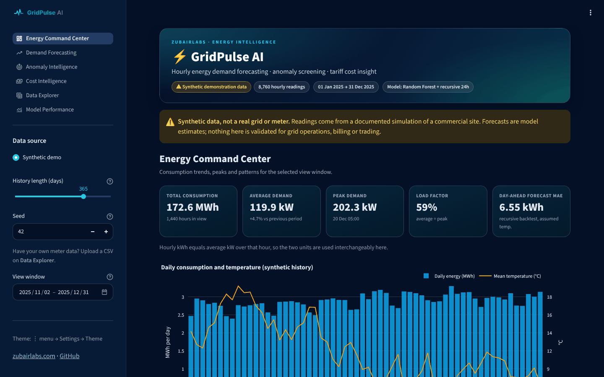

<table>
<tr>
<td width="50%"><strong>Command Center (light)</strong><br>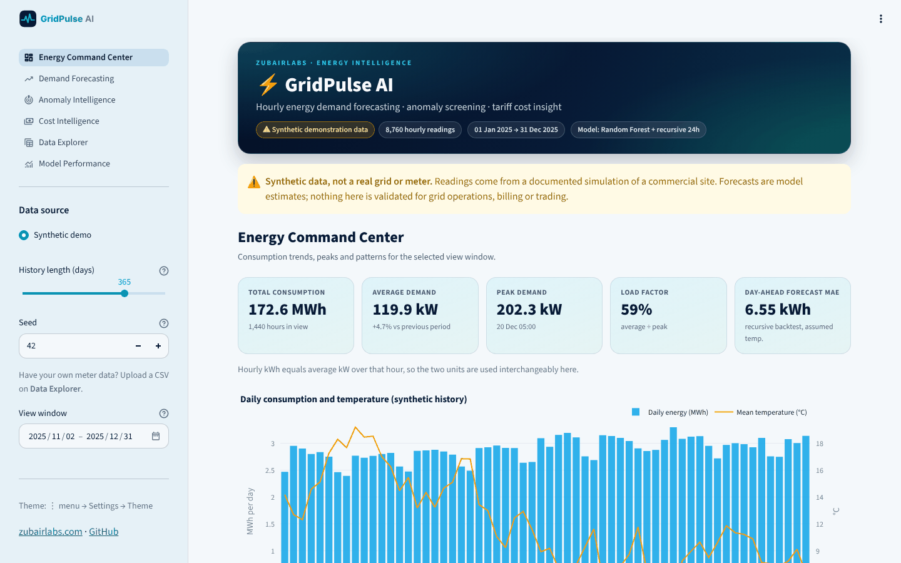</td>
<td width="50%"><strong>Profiles, heatmap, temperature and load duration</strong><br>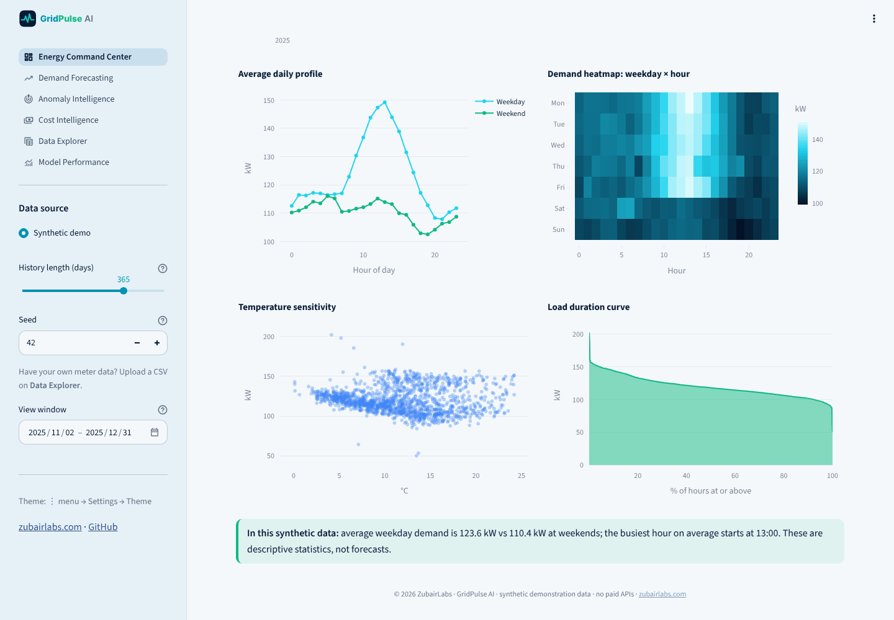</td>
</tr>
<tr>
<td><strong>Demand Forecasting</strong><br>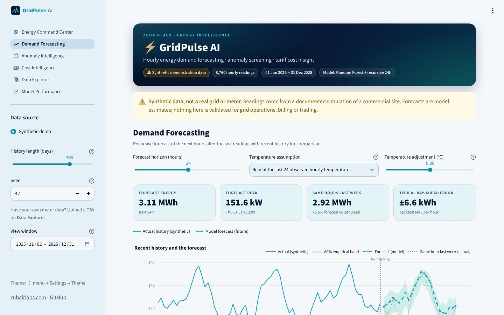</td>
<td><strong>Forecast with error band and temperature assumption</strong><br>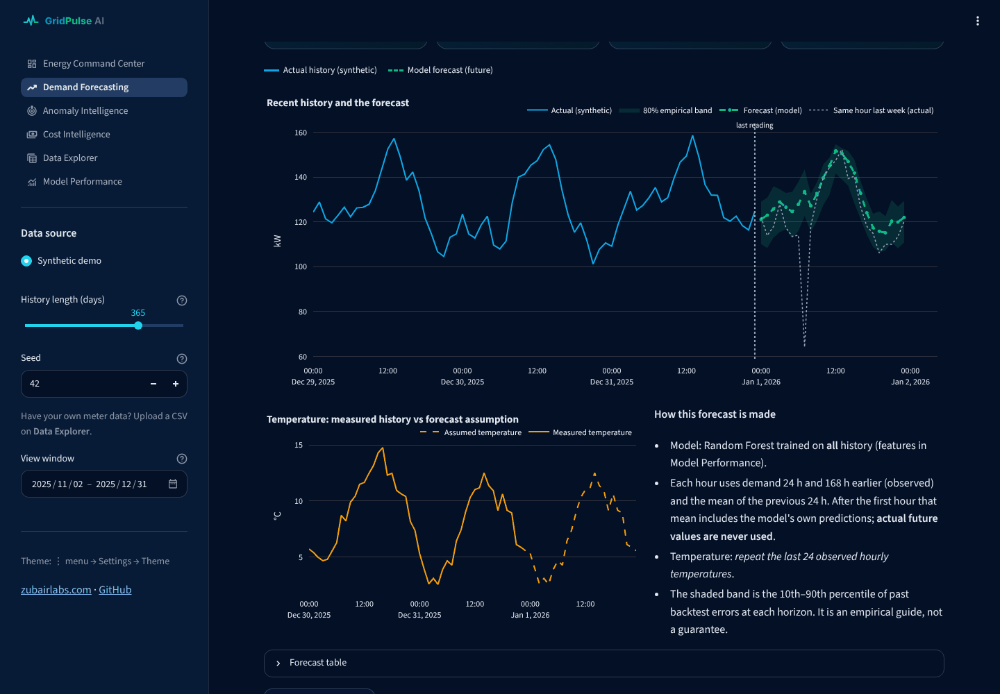</td>
</tr>
<tr>
<td><strong>Anomaly Intelligence</strong><br>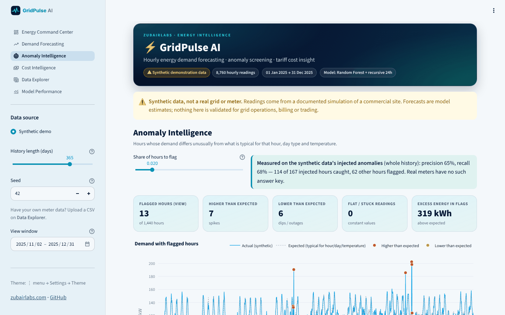</td>
<td><strong>Flagged hours and residuals</strong><br>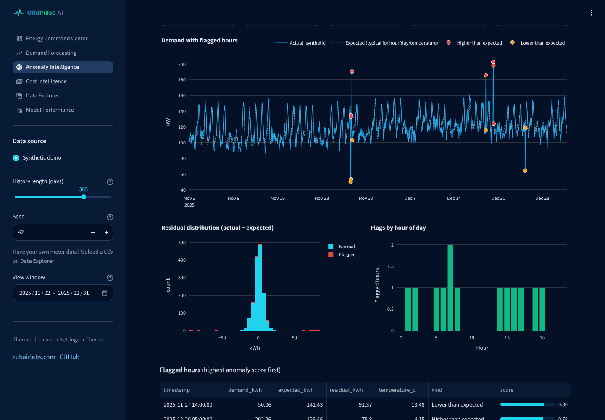</td>
</tr>
<tr>
<td><strong>Cost Intelligence</strong><br>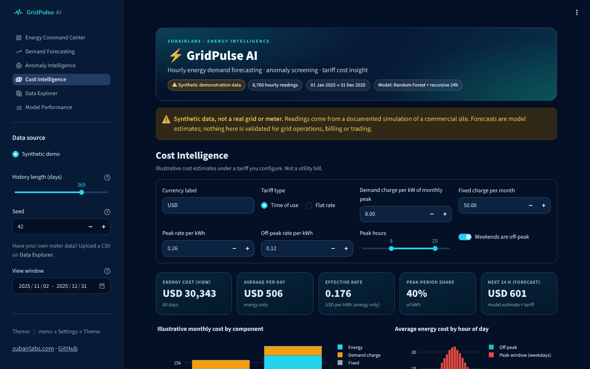</td>
<td><strong>Monthly cost, hourly cost and load-shift what-if</strong><br>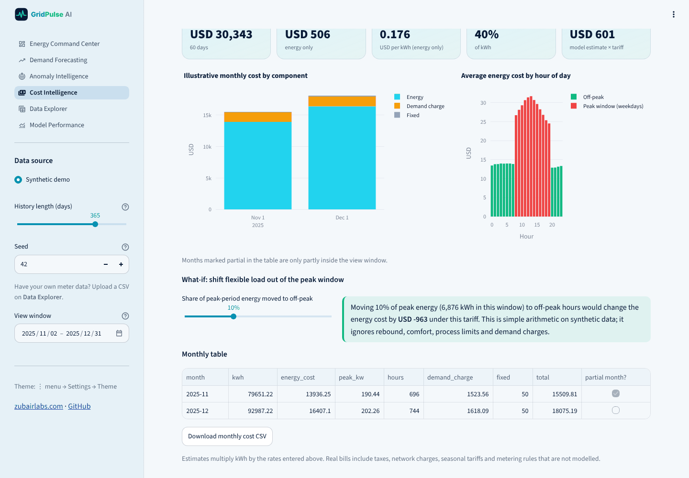</td>
</tr>
<tr>
<td><strong>Model Performance</strong><br>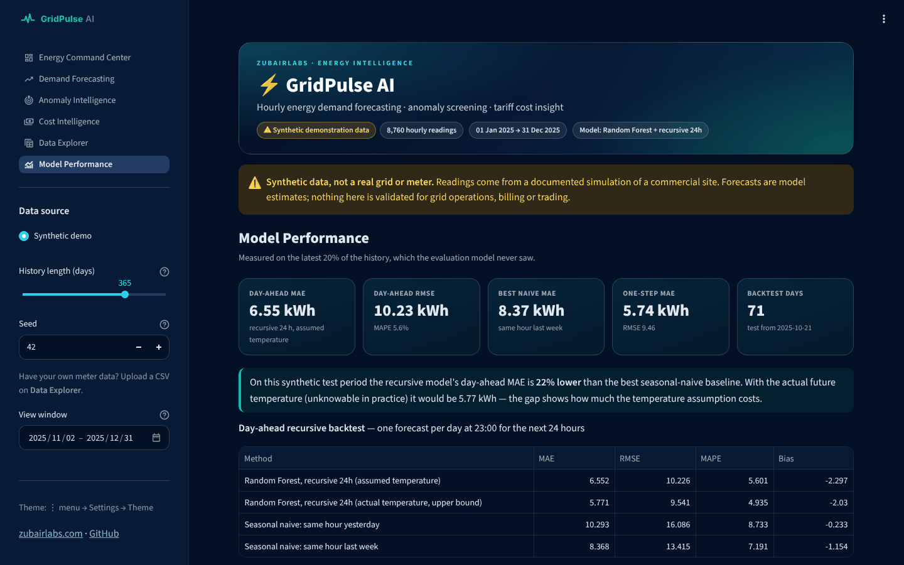</td>
<td><strong>Error by horizon and feature importance</strong><br>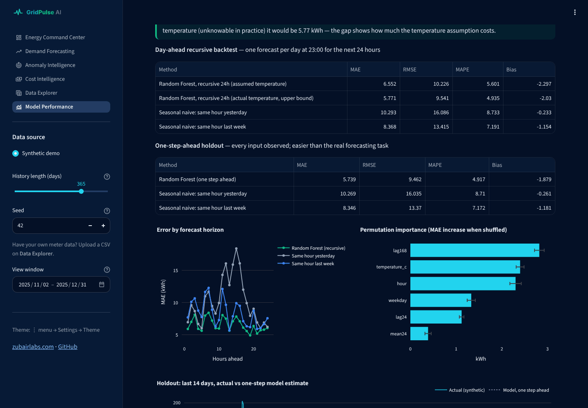</td>
</tr>
<tr>
<td><strong>Holdout and backtest charts</strong><br>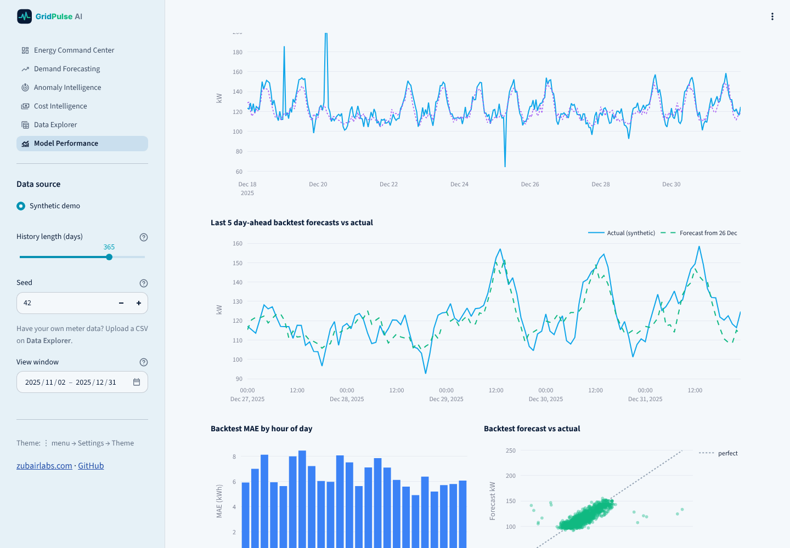</td>
<td><strong>Data Explorer</strong><br>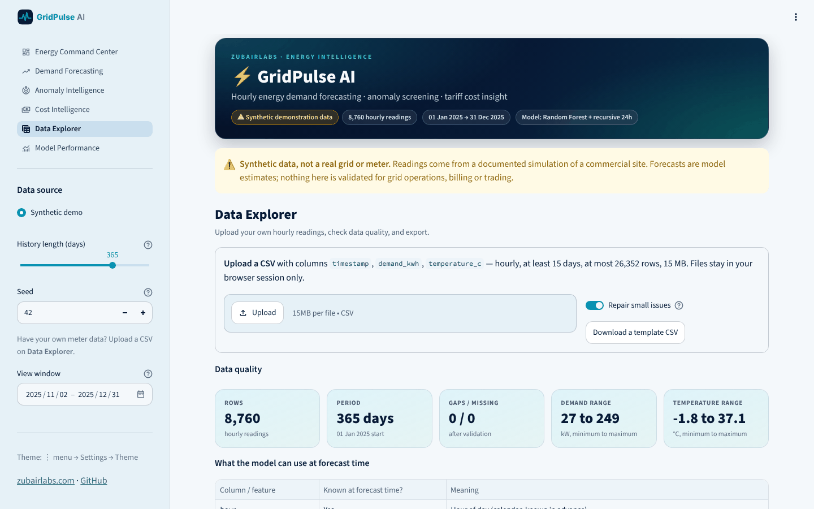</td>
</tr>
</table>

## Model evaluation methodology and results

**Method**

1. Build features; the first week is used only for lags (8,592 feature rows from 8,760 readings).
2. Split chronologically: train on the first 80% (8 Jan to 21 Oct 2025, 6,873 rows), test on the last 20% (21 Oct to 31 Dec 2025, 1,719 rows).
3. **One-step holdout:** predict each test hour with its real lags. This is easier than real forecasting and is reported as a reference.
4. **Day-ahead backtest:** at 23:00 on each of the 71 test days, forecast the next 24 hours recursively with the training-period model, using only data up to that moment and the default temperature assumption. The same run with actual temperatures shows the upper bound.
5. Compare with two baselines known at forecast time: *same hour yesterday* and *same hour last week*.
6. Refit on all rows for the live forecast.

**Results (synthetic data, 365 days, seed 42; reproduced by `python scripts/train.py`)**

Day-ahead recursive backtest (71 forecasts × 24 hours):

| Method | MAE (kWh) | RMSE (kWh) | MAPE | Bias (kWh) |
|:--|--:|--:|--:|--:|
| **Random Forest, recursive 24 h (assumed temperature)** | **6.55** | **10.23** | **5.6%** | −2.30 |
| Random Forest, recursive 24 h (actual temperature, upper bound) | 5.77 | 9.54 | 4.9% | −2.03 |
| Seasonal naive: same hour yesterday | 10.29 | 16.09 | 8.7% | −0.23 |
| Seasonal naive: same hour last week | 8.37 | 13.41 | 7.2% | −1.15 |

One-step holdout (1,719 hours):

| Method | MAE (kWh) | RMSE (kWh) | MAPE |
|:--|--:|--:|--:|
| Random Forest | 5.74 | 9.46 | 4.9% |
| Same hour yesterday | 10.27 | 16.03 | 8.7% |
| Same hour last week | 8.35 | 13.37 | 7.2% |

What this shows:

- The day-ahead forecast's MAE is about **22% lower** than the better baseline. Average demand in the test period is 119 kWh, so a typical hourly error is about 5.5%.
- **Not knowing tomorrow's temperature costs about 0.8 kWh of MAE** (6.55 vs 5.77). A real weather forecast would land somewhere between the two.
- The model **under-forecasts slightly** (bias −2.3 kWh), partly because the test period is the coldest part of the year and the injected anomalies pull the average error.
- Error per horizon ranges from 4.9 to 8.4 kWh, so it does not simply grow with the horizon: hourly patterns matter more.
- RMSE is well above MAE because the injected spikes and dips are left in the test data on purpose.

**Feature importance** (increase in holdout MAE when a feature is shuffled): lag 168 h 2.82 kWh, temperature 2.40, hour 2.30, weekday 1.33, lag 24 h 1.12, mean 24 h 0.39.

**Anomaly screen** (share of hours flagged = 2%, whole year): 176 hours flagged (67 higher than expected, 79 lower, 30 flat / stuck). Against the 167 injected hours: **precision 65%, recall 68%** (114 caught). These are the figures with the pinned dependencies used in CI and on Streamlit Cloud; with pandas 3 the rolling median differs very slightly and one hour changes (64% precision). Real meters have no such answer key, so treat flags as a review list, not a verdict.

More detail in the [model card](docs/MODEL_CARD.md).

## Installation and quick start

Requires Python 3.11 or newer.

```bash
git clone https://github.com/muhammadzubair-data/gridpulse-ai-energy-demand-intelligence.git
cd gridpulse-ai-energy-demand-intelligence
python -m venv .venv
# Windows: .venv\Scripts\activate
# macOS / Linux: source .venv/bin/activate
python -m pip install -r requirements.txt
streamlit run app.py
```

Open the address Streamlit prints (usually `http://localhost:8501`). The first load trains the models and runs the backtest in a few seconds; after that results are cached.

## Example usage

**In the dashboard**

1. **Command Center:** set the *View window* in the sidebar to the period you care about.
2. **Demand Forecasting:** pick a horizon, keep the default temperature assumption, then try +4 °C to see how sensitive tomorrow is to the weather.
3. **Anomaly Intelligence:** start at 2% and sort the table by score; the chart shows each flagged hour against its expected value.
4. **Cost Intelligence:** enter your tariff (time of use, demand charge, fixed charge) and test the load-shift slider.
5. **Data Explorer:** download the template, replace it with your own readings, upload, then press **Analyse this file**. Every page switches to your data, and you can return to the demo at any time.

**From Python**

```python
from gridpulse.core import demo, evaluate, forecast, anomalies, Tariff, monthly_bill

data = demo(days=365, seed=42)
ev = evaluate(data)                      # holdout, day-ahead backtest, importance
print(ev.backtest_summary[["Method", "MAE", "RMSE"]])

tomorrow = forecast(data, horizon=24, model=ev.model, temp_mode="repeat_last_day", temp_offset=2.0)
flags = anomalies(data, rate=0.02)
bills = monthly_bill(data, Tariff(mode="time_of_use", peak_rate=0.26, offpeak_rate=0.12, demand_charge=8))
```

**From the command line**

```bash
python scripts/train.py                                  # synthetic year, seed 42
python scripts/train.py --csv my_meter.csv --repair      # your data
```

This writes `artifacts/gridpulse_model.joblib` and `artifacts/metrics.json`.

## Testing and GitHub Actions

```bash
python -m pytest -q                       # 35 tests
python -m compileall -q app.py gridpulse scripts tests
```

| Area | What is checked |
|:--|:--|
| Data | Seasonal temperatures, weekday above weekend demand, anomaly rate, reproducible seeds, sample CSV matches the generator |
| Validation | Missing columns, gaps, non-numeric values, too few rows and impossible temperatures are rejected; messy headers and time zones are accepted; repair merges duplicates and fills only short gaps |
| Leakage | Features only use the past; recursion feeds back its own predictions; future actuals cannot change a forecast |
| Evaluation | Chronological split, backtest after the training period, all horizons present, model beats both baselines on the synthetic data |
| Anomalies | Flag rate matches the setting; precision and recall against injected events |
| Cost | Flat and time-of-use rates, weekend handling, demand and fixed charges, tariff validation |
| Persistence and CLI | Save/load gives identical predictions; mismatched features are rejected; training script on demo and CSV data |
| App | All six pages render without errors (Streamlit AppTest) |

Browser end-to-end check (every page in light and dark themes, a forecast scenario, a tariff change, six downloads, and invalid and valid CSV uploads):

```bash
pip install -r requirements-dev.txt
python -m playwright install chromium
streamlit run app.py &
python tests/e2e_ui.py http://localhost:8501
```

GitHub Actions ([`.github/workflows/ci.yml`](.github/workflows/ci.yml)) runs the tests on Python 3.11 and 3.12, a compile check and a training-script smoke test, then the browser job, on every push to `main` and on pull requests.

## Deploying to Streamlit Community Cloud

The live app runs with exactly these settings:

1. Fork or push this repository to GitHub.
2. At [share.streamlit.io](https://share.streamlit.io) choose **Create app**, select the repository, branch `main` and main file `app.py`.
3. Under **Advanced settings** choose Python 3.12. No secrets, no `packages.txt` and no paid services are needed.
4. Deploy. `.streamlit/config.toml` carries both themes and caps uploads at 15 MB.

How it is set up for the free tier:

- **Training runs once per dataset.** `evaluate()` (two Random Forests plus the backtest, about 5 s for a year) is cached with `st.cache_resource`; forecasts, anomaly flags and the demo data are cached with `st.cache_data`. Moving a slider or changing a tariff never retrains.
- **Memory is bounded.** Each cached evaluation is roughly 30–70 MB, so at most three are kept and entries expire after an hour.
- **Nothing is written to disk.** Uploaded files are validated in memory and stored only in the visitor's own session, so visitors never see each other's data and no shared file is overwritten. Model files are only written by `scripts/train.py`, and `artifacts/` and `*.joblib` are git-ignored.
- **Bad input fails politely.** Wrong columns, unparsable timestamps, non-numeric values, gaps, duplicates and impossible temperatures produce a readable message instead of a crash.

Even so, don't upload sensitive meter data to a public deployment you haven't reviewed.

## Project structure

```text
gridpulse-ai-energy-demand-intelligence/
├── app.py                         # Streamlit dashboard (6 pages)
├── gridpulse/
│   ├── __init__.py
│   └── core.py                    # data, validation, features, forecast, backtest, anomalies, tariffs, persistence
├── scripts/
│   └── train.py                   # CLI: evaluate and save the model
├── tests/
│   ├── conftest.py
│   ├── test_core.py               # original tests (kept, passing)
│   ├── test_pipeline.py           # leakage, validation, evaluation, cost, persistence, app
│   └── e2e_ui.py                  # Playwright browser checks and screenshots
├── sample_data/
│   └── demo_hourly.csv            # 60 days of synthetic readings
├── assets/
│   ├── hero.svg, architecture.svg, forecasting-pipeline.svg
│   ├── logo.svg, icon.svg
│   └── screenshots/               # real app screenshots
├── docs/
│   └── MODEL_CARD.md
├── .streamlit/config.toml         # light and dark themes, upload limit
├── .github/workflows/ci.yml
├── requirements.txt
├── requirements-dev.txt
├── LICENSE
└── README.md
```

## Limitations

- **Synthetic by default.** The model learns patterns that were written into the generator. Real sites have holidays, occupancy changes, equipment changes and meter quirks that are not simulated.
- **No accuracy or savings claims.** Results describe this simulation only. Real performance has to be measured on real data.
- **Temperature is assumed, not forecast.** A real weather forecast would usually do better than repeating yesterday, but it is not integrated.
- **Single site, single model, one test period.** There is no rolling retraining, drift monitoring or multi-site hierarchy.
- **Error band is empirical.** It comes from past backtest errors and is not a calibrated prediction interval. Beyond 24 hours it reuses the 24-hour band, and the backtest only measures 24-hour accuracy.
- **Anomaly screen is retrospective.** It compares each hour with neighbouring weeks on both sides, so it suits reviewing history, not real-time alerts. Flags are statistical outliers, not confirmed faults.
- **Cost is illustrative.** Taxes, network charges, seasonal tariffs, power factor and contract terms are not modelled.
- **No authentication or storage.** Uploads live only in the browser session.

## Roadmap

- [ ] Weather-forecast input (free source) replacing the persistence assumption
- [ ] Holiday calendar feature
- [ ] Rolling-origin backtests across several seasons
- [ ] Gradient boosting and quantile models compared against the Random Forest
- [ ] Calibrated prediction intervals (conformal)
- [ ] Real-time anomaly mode using only past data
- [x] Leakage-safe recursive forecast with explicit temperature assumption
- [x] Day-ahead backtest against seasonal baselines
- [x] Time-of-use, demand-charge and fixed-charge tariffs
- [x] Validated CSV upload with repair

## Author

**Muhammad Zubair** · ZubairLabs
Data analytics, machine learning and BI dashboards for startups and SMEs.

[zubairlabs.com](https://zubairlabs.com) · [GitHub](https://github.com/muhammadzubair-data) · [LinkedIn](https://www.linkedin.com/in/xubbiofficial/) · [Upwork](https://www.upwork.com/freelancers/xubbiofficial)

**License:** MIT. See [LICENSE](LICENSE).
